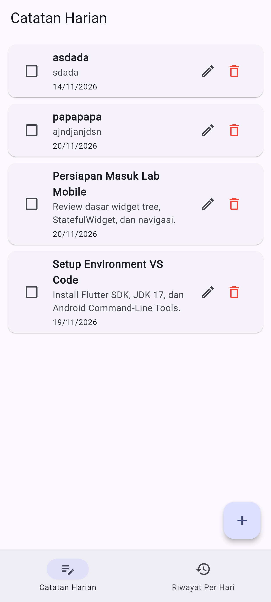
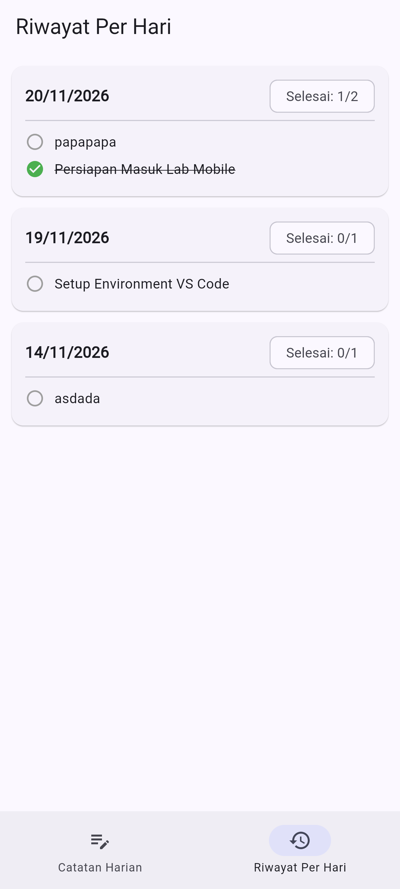
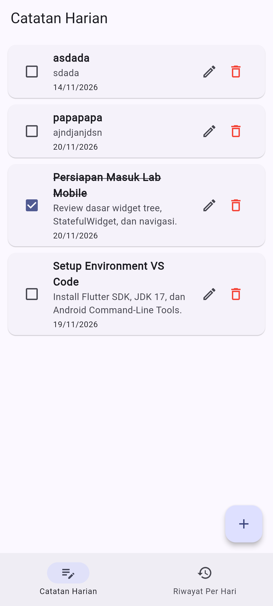

# To-Do List App — Study Case Mobile Programming

Aplikasi pencatat tugas harian (_To-Do List_) berbasis **Flutter** dengan manajemen state lokal (`setState`) untuk memenuhi syarat seleksi Study Group Mobile Programming.

## Identitas Pembuat

- **Nama:** Muhammad Rian Nabil Maulana
- **NIM:** [607062500028]

---

## Unduh Aplikasi (APK)

- [**Download APK Release (Android)**](Aplikasi-Download/TodoList-release.apk)

---

## Fitur & Alur Aplikasi

1. **Halaman Catatan Harian (CRUD Utama)**
   - **Create:** Menekan tombol `+` untuk membuka modal form input berisi _Judul_, _Isi Catatan_, dan pemilihan _Tanggal_ (`DatePicker`).
   - **Read & Checklist:** Menampilkan daftar seluruh catatan yang tersimpan di memori aplikasi. Pengguna dapat mencentang _checkbox_ untuk menandai catatan sudah selesai (_strikethrough_).
   - **Update:** Menekan ikon pensil pada item catatan untuk membuka kembali form modal dengan data lama dan memperbaruinya.
   - **Delete:** Menekan ikon tempat sampah untuk menghapus catatan dari daftar.

2. **Halaman Riwayat Per Hari**
   - Berpindah halaman melalui **NavigationBar** di bagian bawah layar.
   - Sistem secara otomatis mengelompokkan seluruh catatan berdasarkan tanggal (`YYYY-MM-DD`) dan mengurutkannya dari tanggal terbaru.
   - Menampilkan ringkasan rasio tugas yang selesai (`Selesai: X/Y`) beserta daftar judul catatan pada masing-masing tanggal.

---

## Deklarasi Penggunaan AI

### Deklarasi Penggunaan AI

- Apakah menggunakan AI? (Ya)
- Tool AI yang digunakan: (contoh: Gemini)
- Estimasi persentase kontribusi AI: 30%
- Bagian kode/fitur yang dibantu AI:
  (contoh: Penulisan code Main agar selaras dengan kode sebelumnya yang sudah ada,template README)
- Pernyataan:
  "Saya menyatakan bahwa saya memahami alur dan fungsi dari seluruh kode yang ada dalam repositori ini"

## Screenshot Aplikasi

|                      Catatan Harian                      |                   Form Tambah / Edit                    |                     Riwayat Per Hari                     |
| :------------------------------------------------------: | :-----------------------------------------------------: | :------------------------------------------------------: | --------------------------------------------------------------- |
|  |  |  |  |

---
